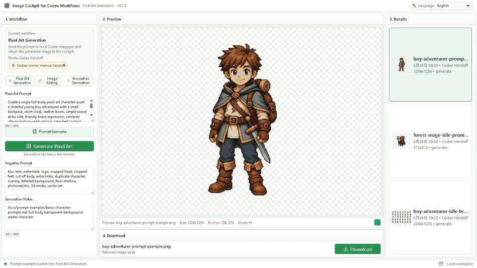
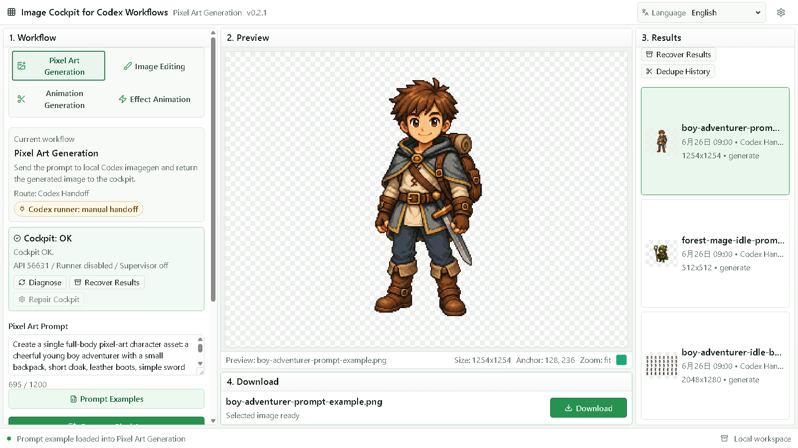
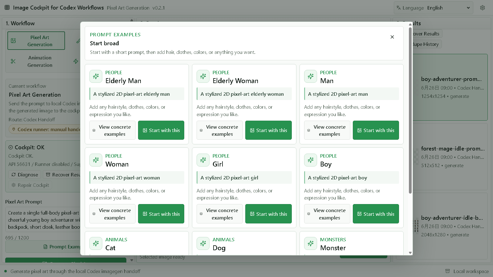
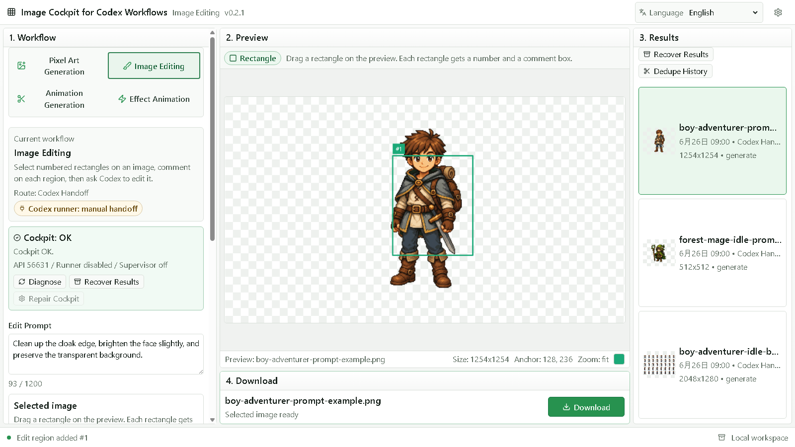
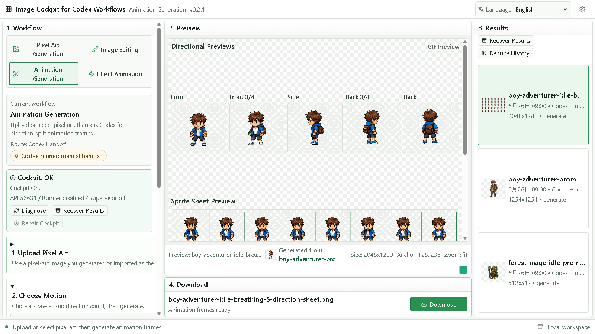

# Zai Cockpit

Local image production cockpit running on the Z.ai model ecosystem.

Zai Cockpit is a local workspace for generating pixel art with Z.ai image models, editing images, and turning selected pixel-art assets into animation frames and sprite sheets. It is a fork of [image-cockpit-for-codex-workflows](https://github.com/dreiachse-cyber/image-cockpit-for-codex-workflows) with the Codex CLI provider replaced by a built-in Z.ai agent runner.



## How Generation Runs

Zai Cockpit writes a local handoff job (a JSON contract) into `zai-handoff/inbox/`, then spawns the built-in **Z.ai agent runner** (`scripts/zai-agent-runner.mjs`). The runner drives a GLM chat model through an OpenAI-compatible tool loop and gives it a `generate_image` tool backed by Z.ai GLM-Image. Final images land in `zai-handoff/outbox/` and are imported back into the UI automatically.

```text
zai-handoff/
  inbox/   # job contracts written by the cockpit
  outbox/  # images and manifests returned by the runner
  status/  # runner state per job
  logs/    # runner transcript per job
```

### Billing: coding plan first, pay-as-you-go second

Z.ai bills the two endpoints differently, so the runner picks them deliberately:

- **Chat completions** (the agent brain — nearly all tokens) go to the **GLM Coding Plan endpoint** by default: `https://api.z.ai/api/coding/paas/v4`. If you have an active coding plan subscription, this traffic is covered by the plan instead of per-token billing.
- With `ZAI_ENDPOINT_MODE=auto` (the default), the runner falls back to the pay-as-you-go endpoint `https://api.z.ai/api/paas/v4` only when the coding endpoint rejects the request because no coding plan is active on the key.
- **Image generation** always goes to the pay-as-you-go endpoint, because Z.ai serves image models only there. Each generated image is billed per image.

Set `ZAI_ENDPOINT_MODE=coding` or `ZAI_ENDPOINT_MODE=api` to pin a single endpoint instead of using the coding-first fallback.

## Setup

```powershell
npm install
Copy-Item .env.example .env   # then set ZAI_API_KEY
npm run dev:all
```

`npm run dev:all` starts both the local handoff API and the Vite app. If the default Vite port is busy, Vite will print the actual local URL.

You can still run the two processes separately:

```powershell
npm run dev:server
npm run dev
```

1. Create an API key at [z.ai](https://z.ai/model-api) — if you subscribe to the GLM Coding Plan, create the key from the plan page so it can use the coding endpoint.
2. Put the key in `.env` as `ZAI_API_KEY=...`.
3. Run `npm run doctor` for a local setup diagnosis without starting the UI.

### Configuration

```text
ZAI_API_KEY=...                    # required for autorun
ZAI_ENDPOINT_MODE=auto             # auto | coding | api (auto = coding plan first)
ZAI_CODING_BASE_URL=https://api.z.ai/api/coding/paas/v4
ZAI_API_BASE_URL=https://api.z.ai/api/paas/v4
ZAI_CHAT_MODEL=glm-4.7            # agent model (coding-plan billed)
ZAI_IMAGE_MODEL=glm-image          # image model (pay-as-you-go billed)
ZAI_COCKPIT_API_PORT=8787
ZAI_COCKPIT_HANDOFF_DIR=zai-handoff
ZAI_COCKPIT_RUNNER_AUTORUN=1        # 0 disables autorun and keeps manual handoff only
ZAI_COCKPIT_RUNNER_COMMAND=         # optional custom runner executable (default: node + built-in agent runner)
ZAI_COCKPIT_RUNNER_HELP_ARGS_JSON=  # optional JSON array for wrapper preflight args
ZAI_COCKPIT_RUNNER_EXEC_ARGS_JSON=  # optional JSON array for wrapper exec args
ZAI_COCKPIT_ALLOW_MOCK_RUNNER=0     # keep 0 outside automated smoke tests
```

Runner preflight can be checked directly:

```powershell
Invoke-RestMethod http://127.0.0.1:8787/api/zai/runner
```

Zai Cockpit refuses to report a mock/test runner as ready unless `ZAI_COCKPIT_ALLOW_MOCK_RUNNER=1` is set explicitly for automated smoke tests. A mock runner proves lifecycle wiring only; it is not a real Z.ai image generation backend.

## Core Flow

- Start directly in the workspace and switch between three tabs: Pixel Art Generation, Image Editing, and Animation Generation.
- Open Prompt Examples from directly below the Pixel Art Prompt field, then copy tuned prompts or load one into Pixel Art Generation from the modal.
- Generate pixel art from a prompt through the Z.ai agent runner.
- Use Image Editing to select numbered rectangular regions, add edit comments, and send the selected source plus notes through the handoff.
- In Animation Generation, choose a pixel-art source, select a validated motion preset, generate direction frames, then download animated GIF, animated WebP, or the composed sprite sheet.
- Review returned images and animation artifacts in the shared preview area.
- Use the local download panel to export PNG still images, animation previews, sprite sheets, frame ZIPs, and animation packs when the selected result supports them.

## Screenshots

Pixel Art Generation:



Prompt Examples:



Image Editing:



Animation Generation:



## Manual Handoff

With `ZAI_COCKPIT_RUNNER_AUTORUN=0`, the cockpit only writes job contracts into `zai-handoff/inbox/`. Complete them with any tool you like (including a different agent), place images with the job id filename prefix into `zai-handoff/outbox/`, and the UI imports them.

## Verification

```powershell
npm run doctor       # setup diagnosis
npm run typecheck    # tsc --noEmit
npm test             # vitest
npm run build        # production build
npm run smoke        # API contract smoke (no Z.ai key required, autorun off)
npm run zai:smoke    # real runner smoke (requires ZAI_API_KEY)
npm run verify       # doctor + typecheck + test + build + smoke + release:audit
```

CI runs the same verification on every push ([workflow](.github/workflows/ci.yml)).

## Generated Outputs And Rights

Generated images are created under your own Z.ai account; check your plan's terms for commercial use of generated assets. The sample sheets under `public/samples/` and prompt example images are upstream demo material kept for the UI.

## Credits And License

- Upstream project: [image-cockpit-for-codex-workflows](https://github.com/dreiachse-cyber/image-cockpit-for-codex-workflows) by dreiachse-cyber (MIT).
- This fork replaces the Codex CLI provider with the Z.ai API agent runner described above.

Licensed under the [MIT License](LICENSE). See [CHANGELOG.md](CHANGELOG.md), [CONTRIBUTING.md](CONTRIBUTING.md), [SECURITY.md](SECURITY.md), and [CODE_OF_CONDUCT.md](CODE_OF_CONDUCT.md). More prompt examples live in [docs/prompt-examples/](docs/prompt-examples/README.md).
